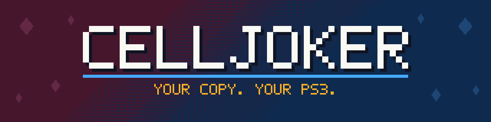
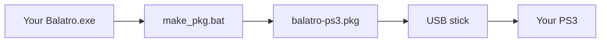

  

<h3 align="center">Balatro on a PlayStation 3. Drag one file, get a PKG. </h3>

  
  
  
  

You own Balatro. You own a PS3. CellJoker runs one on the other. The game runs from its own unmodified Lua code, on a new LÖVE 11 runtime written for the PS3.

This repository contains no game files. The tool reads your `Balatro.exe` and makes the package on your PC.

> CellJoker is not made or approved by LocalThunk, Playstack, or Sony. Balatro belongs to its owners. PlayStation belongs to Sony Interactive Entertainment. Buy the game, it is great.

## ♠ Get it running in four steps

1. Download [`make_pkg-1.0.0.zip`](../../releases/latest) and unzip the whole folder.
2. Drag `Balatro.exe` onto `make_pkg.bat`. The game is in `Steam\steamapps\common\Balatro`.
3. Wait a minute or two. Copy `balatro-ps3.pkg` to the root of a FAT32 USB stick, not to a folder.
4. On the PS3, go to Game > Package Manager > Install Package Files.

You do not need to install Python, Docker, or a compiler. The zip has all the tools.

Do not share the package. It contains the game.

## ♥ What you get

| | |
|---|---|
| **The full game** | All 150 jokers, 15 decks, 52 tarot, planet and spectral cards, 32 vouchers, and 32 packs ran with no crash in scripted tests. |
| **Sound and music** | A software mixer plays the game's own music and sound effects. |
| **Saves** | Your run and settings save by themselves. |
| **The look** | The CRT effect, the swirling background, and the card shaders run on the PS3 graphics chip. |
| **11 languages** | English, German, Spanish (2 versions), French, Indonesian, Italian, Dutch, Polish, Portuguese, and Russian. |
| **A pad** | The game plays with a controller. |
| **No grind** | The main profile has everything unlocked, and the tutorial is off. To start fresh, change to another profile in the game's Profile menu. |

### Controls

| Button | Action |
|---|---|
| D-pad | Select. Press it first on each screen. |
| Cross | Confirm |
| Circle | Back |
| Square | Play hand |
| Triangle | Discard |

## ♣ Status

| Where | Result |
|---|---|
| RPCS3 | The game plays with sound and saves. |
| Real PS3 | Tested on 2 runs, and it ran fine. Please [open an issue](../../issues) with your result. |

The game runs in 11 languages. Japanese, Korean, and Chinese are not available, because their fonts are too large. This release was tested with Balatro 1.0.1o-FULL.

If something goes wrong, the log is on the PS3 at `/dev_hdd0/tmp/balatro_log.txt`.

## ♦ How it works

Balatro is Lua code on the LÖVE framework, and LÖVE does not run on a PS3. CellJoker replaces LÖVE, and the game does not know the difference.

- `runtime/` is a subset of LÖVE 11 in C, on the open-source [PSL1GHT](https://github.com/ps3dev/PSL1GHT) SDK.
- `tools/shader_translate.py` translates the game's GLSL shaders to Cg for the RSX graphics chip.
- `tools/texture_cook.py` converts the game's textures to a format that the RSX can read.
- `tools/make_pkg.py` joins the runtime and your game files into one package.

To build from source, you need Docker. `docs/HANDOFF.md` has the commands, the project layout, and the test scripts.

## Credits

CellJoker uses PSL1GHT, Lua, FreeType, libogg, libvorbis, zlib, the NVIDIA Cg Toolkit, Python, and Pillow. Each one keeps its own license.

Built with Claude Code.

## License

The code in this repository uses the [MIT license](LICENSE). The license does not cover Balatro.
